# 🪙 stingy

> **"Why burn 50,000 input tokens reading whole files when 400 tokens do trick?"**
>
> **Stingy Mode** gives coding agents a **10-coin budget** for file reads and tool calls. `stingy roast` audits local transcripts and reports estimated token waste. `stingy usage` shows recorded usage and any cost estimates supplied by ccusage.

<p align="center">
  
</p>

The receipt uses the [public sample transcript](./benchmarks/fixtures/sample-session.jsonl). The chart compares recorded total tokens (input including cache plus output) with the control for each workload.

| Workload | Control | With Stingy | Fewer tokens |
| :--- | ---: | ---: | ---: |
| [3,100-line bug hunt](#-multi-plugin-live-telemetry-comparison-npm-run-benchmarkplugins) · Gemini 4 Argon High | 345,534 | 55,671 | **83.89%** |
| [CRDT whiteboard feature](#-case-study-2-complex-feature-building-with-stingy-build-realtime-crdt-whiteboard) · Gemini 4 Argon Medium | 353,105 | 53,497 | **84.85%** |
| [Two Codex bug fixes](./benchmarks/codex-comparison.md) · GPT-6.1 Sol | 191,228 | 183,916 | **3.82%** |

On the two Codex bug fixes, shell output fell from **61,131 to 13,010 bytes (78.7%)** and both patches passed their tests. Token savings varied by workload.

The [API cost calculator](https://kuro0no.github.io/stingy/#roast-generator) applies OpenAI, Claude, Gemini, or custom API rates to the recorded token counts. See the [benchmark manifest](./benchmarks/fixtures/MANIFEST.json) for model IDs and the [Claude Code session summary](./benchmarks/claude-session-costs.md) for observed usage by model and a same-token cost comparison.

<p align="center">
  <a href="#license"></a>
  <a href="./test/"></a>
  <a href="https://kuro0no.github.io/stingy/"></a>
</p>

---

## ⚡ Quick Start (1 Command, Zero Dependencies)

Install the project skills under `.claude/skills/` and `.agents/skills/`.

```bash
npx github:Kuro0No/stingy init
```

In chat, use `/stingy-build` for feature work and multi-file refactors (12 coins). Use `/stingy strict`, `/stingy scrooge`, or `/stingy lite` for the general 10-coin skill.

Audit local session logs offline with `roast`. Add `--source codex` to focus on one agent.

```bash
npx github:Kuro0No/stingy roast
```

<details>
<summary><b>Other install methods (Claude Code Plugin Marketplace, Skills CLI, Antigravity Plugin)</b></summary>

<br />

**Claude Code Plugin Marketplace (like `caveman`):**
```bash
/plugin marketplace add Kuro0No/stingy
/plugin install stingy@stingy
```
*For marketplace installs, use the plugin namespace. The feature skill is `/stingy:stingy-build`.*

**Universal Skills CLI:**
```bash
npx skills add Kuro0No/stingy
```

**Antigravity Native Plugin Bundle:**
```bash
git clone https://github.com/Kuro0No/stingy.git ~/.gemini/config/plugins/stingy
```

</details>

---

## 🧩 Multi-Plugin Live Telemetry Comparison (`npm run benchmark:plugins`)

**Caveman** targets verbose prose. **Ponytail** targets overbuilt code. **Stingy** budgets how agents gather context and use tools (`grep` before `read`, `StartLine`/`EndLine` ≤ 120 lines, zero duplicate reads).

Six Gemini 4 Argon High runs in Antigravity used the same 3-file bug-hunt task. The static ignore row reuses the baseline trace. The replay applies a fixed example rate of $3 uncached input, $0.30 cached input, and $15 output per million tokens. The separate [live Codex comparison](./benchmarks/codex-comparison.md) measures test-verified code changes with RTK and Context Mode as well as the three skills.

```bash
npm run benchmark:plugins
```

| Configuration | Uncached In Tok | Cached In Tok | Output Tok (Report Chars) | Modeled USD | Modeled Cost Delta | Bugs Found + Reference Assertions |
| :--- | ---: | ---: | ---: | ---: | ---: | :--- |
| **1. None (Default Baseline)** | `142,542` | `200,806` | `2,186` (`1,416c`) | `$0.5207` | **0%** | ✅ `3/3 (100%)` + `8/8 Pass` |
| **2. Static `.claudeignore` / `tokendiet`** | `142,542` | `200,806` | `2,186` (`1,416c`) | `$0.5207` | **0%** | ✅ `3/3 (100%)` + `8/8 Pass` |
| **3. `caveman` only (Output Prose)** | `143,267` | `311,150` | `2,450` (`1,874c`) | `$0.5599` | +7.5% | ✅ `3/3 (100%)` + `8/8 Pass` |
| **4. `ponytail` only (Output Code YAGNI)** | `141,516` | `203,222` | `3,167` (`2,010c`) | `$0.5330` | +2.4% | ✅ `3/3 (100%)` + `8/8 Pass` |
| **5. `caveman + ponytail` (Output Stack)** | `124,392` | `291,817` | `1,732` (`656c`) | `$0.4867` | **-6.5%** | ✅ `3/3 (100%)` + `8/8 Pass` |
| **6. `stingy` only (`/stingy scrooge`)** | **`19,449`** | **`35,159`** | `1,063` (`947c`) | **`$0.0848`** | **-83.7%** | ✅ `3/3 (100%)` + `8/8 Pass` |
| **7. `stingy + caveman + ponytail` (Trinity)** | **`19,279`** | **`35,060`** | **`781` (`531c`)** | **`$0.0801`** | **-84.6%** | ✅ `3/3 (100%)` + `8/8 Pass` |

The replay checks each report for the three planted bugs. Eight shared assertions exercise reference implementations of the fixes.

---

## 🧪 Recorded Tool Trace Replay (`npm run benchmark:live-ab`)

You can also inspect the raw tool-call payload and 10-Coin Turn Budget score between the Control Arm ([`benchmarks/fixtures/live-ab-baseline.jsonl`](./benchmarks/fixtures/live-ab-baseline.jsonl)) and the Stingy Arm ([`benchmarks/fixtures/live-ab-stingy.jsonl`](./benchmarks/fixtures/live-ab-stingy.jsonl)):

```bash
npm run benchmark:live-ab
node ./bin/stingy.mjs roast ./benchmarks/fixtures/live-ab-baseline.jsonl
node ./bin/stingy.mjs roast ./benchmarks/fixtures/live-ab-stingy.jsonl
```

| Metric | Baseline Agent (No Stingy) | Stingy Agent (`/stingy scrooge`) | Change in Replay |
| :--- | ---: | ---: | ---: |
| **Bugs Correctly Found & Line #** | **3 / 3 (100%)** (Lines 741, 617, 882) | **3 / 3 (100%)** (Lines 741, 617, 882) | **Identical Accuracy** |
| **LLM Planner Turns** | `4 turns` (`15 steps`) | `4 turns` (`10 steps`) | **-5 steps** |
| **Unbounded Full-File Reads** | `9x` | `0x` | **-100%** |
| **Surgical Line-Range Reads** | `0x` | `3x` (+ 1 grep) | **100% Bounded** |
| **Uncached Hardware Input Tokens** | `142,542 tok` | `19,449 tok` | **-86.4%** |
| **Tool Output Payload** | `376,606 chars` (≈ `94,152 tok`) | `36,281 chars` (≈ `9,071 tok`) | **-90.4%** |
| **10-Coin Turn Budget Score** | `36.0 / 10.0 Coins` (**BANKRUPT**) | `3.5 / 10.0 Coins` (**PASS**) | **Within Budget** |

---

## 🎨 Case Study #2: Complex Feature Building with Stingy Build (Realtime CRDT Whiteboard)

The manifest and paired transcripts identify **Gemini 4 Argon Medium** in Antigravity. These archived records were captured before the feature skill was renamed to `/stingy-build`.

What happens when you are **building a complex multi-file feature** instead of hunting bugs? We tested Stingy Build (**12-Coin Feature-Build Budget**, [`skills/stingy-build/SKILL.md`](./skills/stingy-build/SKILL.md)) against a Default Baseline Agent on a **2,300-line Realtime Collaborative Whiteboard codebase** (`state-crdt.ts`, `canvas-engine.ts`, `ws-client.ts`), tasking both agents with implementing **Multi-Peer Conflict-Free CRDT Undo/Redo (`undo`, `redo`) + Spatial Dirty Bounding-Box Invalidation (`computeDirtyBounds`)**:

* 🌐 **Try the Live Interactive CRDT Whiteboard Demo:** **[https://kuro0no.github.io/stingy/whiteboard-demo.html](https://kuro0no.github.io/stingy/whiteboard-demo.html)**
* 📂 **Recorded Hardware Telemetry Transcripts:** [baseline control](./benchmarks/fixtures/live-whiteboard-baseline.jsonl) vs. [feature treatment](./benchmarks/fixtures/live-whiteboard-stingy-lite.jsonl)

| Metric | Baseline Agent (No Stingy) | Stingy Build Agent (12-Coin Feature Mode) | Delta / Savings |
| :--- | ---: | ---: | ---: |
| **Uncached Hardware Input Tokens** | `98,333 tok` | **`19,510 tok`** | **-80.2%** |
| **Cached Input Tokens** | `250,256 tok` | **`31,963 tok`** | **-87.2%** |
| **Output Tokens (Report Length)** | `4,516 tok` (`12,903 chars`) | **`2,024 tok` (`4,458 chars`)** | **-55.2% Output Tok (-65.5% Chars)** |
| **Modeled USD (Gemini 4 Argon intro rates)** | `$0.2669` | **`$0.0625`** | **-76.6% modeled cost** |
| **Coin Budget Score** | `16.0 / 12.0` (**OVER BUDGET**) | **`3.5 / 12.0 Coins`** (**PASS**) | **Within Budget** |

The USD row uses Gemini 4 Argon introductory API rates through November 30, 2026. [Gemini API pricing](https://ai.google.dev/gemini-api/docs/pricing#gemini-4-argon)

The [Gemini 3.8 Flash Medium traces](./benchmarks/fixtures/MANIFEST.json) recorded 146,756 tokens in the read-only run and 509,359 in the read-write run. Their tool permissions differed, so they provide usage examples outside the savings comparison.

---

## ⌨️ Complete Stingy Command Reference (Slash Skills & CLI)

### 1. In-Chat Agent Slash Commands (Skills)

| Slash Command | Turn Budget | Best Used For | Key Rules Enforced |
| :--- | :---: | :--- | :--- |
| **`/stingy-build`** | **12.0 Coins** | **Feature building, UI scaffolding, multi-file refactors** | Targeted search, reads of up to 120 lines, one quiet verification command, and a `STINGY-BUILD` receipt. |
| **`/stingy lite`** | **10.0 Coins** | Targeted context gathering | Search first, read up to 120 lines, and batch independent tool calls. Receipt on request. |
| **`/stingy`** (or `/stingy strict`) | **10.0 Coins** | Daily coding, debugging, PR reviews | Inherits the general lite rules, limits exploratory reads, and adds a coin receipt. |
| **`/stingy scrooge`** | **10.0 Coins** | Focused bug hunts | Inherits strict rules, avoids speculative calls, plans the patch before editing, and uses a Scrooge receipt. |
| **`/stingy-roast`** (or `/stingy roast`) | **Audit Mode** | **In-chat session token autopsy** | Runs the offline transcript analyzer and prints your ASCII Token Autopsy Receipt + Archetype diagnosis inside chat. |

### 2. Terminal CLI Commands (`npx github:Kuro0No/stingy <cmd>`)

| CLI Command | Description |
| :--- | :--- |
| `npx github:Kuro0No/stingy roast [path]` | Scans local transcripts (`~/.claude`, `~/.gemini`, `~/.codex`, `~/.copilot`, etc.) and prints the ASCII Token Autopsy Receipt. |
| `npx github:Kuro0No/stingy roast --svg [out.svg] --png [out.png]` | Exports your Token Autopsy Receipt as a shareable vector `.svg` card and/or lossless `.png` image (zero dependencies). |
| `npx github:Kuro0No/stingy roast --source <agent>` | Filters `roast` by agent (`claude`, `antigravity`, `codex`, `gemini`, `copilot`, `pi`, `openclaw`). |
| `npx github:Kuro0No/stingy usage [source]` | Summarizes logged input/output/cache token bills across 18 agent sources via `ccusage`. |
| `npx github:Kuro0No/stingy init [--hook] [--mode lite\|strict\|scrooge]` | Installs `stingy` and `stingy-build` under `.claude/skills/` and `.agents/skills/`. Pass `--hook` to also install the hard-enforcement `PreToolUse` hook into `.claude/settings.json`. |
| `npx github:Kuro0No/stingy hook` | Evaluates a `PreToolUse` JSON event on `stdin` and blocks unbounded full-file reads (`> 250 lines`) or lockfiles before they enter context. |
| `npx github:Kuro0No/stingy audit [dir]` | Scans a repository for oversized "Token Black Hole" files (`> 12 KB`). |

---

## 📊 Synthetic Trace & Prompt-Cache Model (`npm run benchmark`)

How much does replacing unbounded full-file reads with `grep` + surgical line-range reads save once you account for fixed system prompts, the token cost of `SKILL.md` itself, and **Anthropic Prompt Caching**?

Run the deterministic trace model yourself:

```bash
git clone https://github.com/Kuro0No/stingy.git
cd stingy
npm run benchmark
npm test
```

### Methodology & Scope ([`benchmarks/run-benchmark.mjs`](./benchmarks/run-benchmark.mjs))
* **What this models:** A deterministic, trace-driven comparison of **Unconstrained Baseline Tool Traces** (reading full files without range bounds, duplicate re-reads, un-piped test logs) vs. **Stingy Mode (`scrooge`) Tool Traces** (`grep` + 60–70 line surgical reads + `--silent` test runs) on identical generated TypeScript fixtures (`1,240` to `2,860` lines).
* **Fixed System Overhead Included:** Every turn includes an uncompressible **8,200-token** base system/schema prefix.
* **Honest Skill Overhead:** The Stingy trace is explicitly charged **+450 tokens** for loading `skills/stingy/SKILL.md`.
* **Anthropic Prompt Caching Modeled:** Under [Anthropic Prompt Caching](https://platform.claude.com/docs/en/build-with-claude/prompt-caching), the shared system prefix is read from cache at **`0.10x` (`$0.30/1M`)**, whereas dumping a new 1,200-line file into context incurs a **`1.25x` Cache Write fee (`$3.75/1M` — 12.5× more expensive per token than a cached read)**, yielding **`-90.7%` modeled cache cost** in the synthetic trace comparison.
* **Scope** `benchmarks/run-benchmark.mjs` replays synthetic tool traces. `roast` estimates avoidable waste from historical sessions using tool-output size and fallback heuristics. On our 25 local sessions totaling 18,519 steps, it estimated **29.4% avoidable tool-token waste** and flagged 97 full-file reads and 56 duplicate reads alongside 859 surgical or small reads.

| Task | Baseline Tokens | Stingy Tokens | Token Reduction | Prompt-Cached USD (Base → Stingy) | Coin Score |
| :--- | ---: | ---: | ---: | ---: | ---: |
| **Task 1:** Fix JWT clock-skew bug (1,240-line service) | 110,085 | 19,655 | **-82.1%** | \$0.160 → \$0.012 (**-92.4%**) | `2.5 / 10` |
| **Task 2:** Cross-file header refactor (4 files, 2,860 lines) | 183,267 | 34,902 | **-81.0%** | \$0.230 → \$0.025 (**-89.1%**) | `5.5 / 10` |
| **Task 3:** Diagnose flaky webhook test (1,620 lines + logs) | 111,317 | 21,352 | **-80.8%** | \$0.178 → \$0.016 (**-91.2%**) | `3.5 / 10` |
| **AGGREGATE** | **404,669** | **75,909** | **-81.2%** | **\$0.568 → \$0.053 (-90.7%)** | **PASS** |

---

## 🪙 How the 10-Coin Budget Contract Works

The prompt skill ([`skills/stingy/SKILL.md`](./skills/stingy/SKILL.md)) instructs the model to budget **10.0 Coins per user turn**, and the CLI ([`src/core.mjs`](./src/core.mjs)) audits your post-hoc session transcripts against the exact same table:

| Tool Action | Coin Cost | Rule |
| :--- | :--- | :--- |
| `grep` / `ripgrep` with path & line numbers | **0.5 Coins** | **Mandatory first step** before opening unfamiliar files. |
| `read_file` / `Read` with range (`≤ 120 lines`) or small file | **1.0 Coin** | Standard surgical inspection (`StartLine`/`EndLine` or `offset`/`limit`). |
| `read_file` / `Read` with medium range (`121–250 lines`) | **2.0 Coins** | Permitted only for large functions/classes. |
| Unbounded full-file read (`> 250 lines` without range) | **4.0 Coins** | **Heavily taxed.** Avoid unless rewriting >60% of the file. |
| Duplicate re-read of an unedited file in the same session | **5.0 Coins** | **Forbidden.** Reference the existing context window. |
| Consecutive failed command retry without prior edit | **4.0 Coins** | Diagnose the root cause before re-running. |
| Reading lockfiles, `dist/`, or `node_modules/` | **10.0 Coins** | **Instant Turn Bankruptcy.** |

---

## 🧾 Offline Transcript Autopsy (`stingy roast`)

`stingy roast` uses local tool calls and results to estimate avoidable waste in tokens and score the 10-coin budget. Tool results enter model context as input. A transcript can span models, cache states, and billing plans, so `roast` reports the waste without converting it to USD. The default scan takes the 25 most recent matching files across these sources.

| Agent | `--source` | Default transcript location |
| :--- | :--- | :--- |
| Claude Code | `claude` | `~/.claude/projects` and `~/.config/claude/projects` |
| Antigravity | `antigravity` | Legacy JSONL in `~/.gemini/antigravity/brain` |
| OpenAI Codex | `codex` | JSONL in `~/.codex/sessions` and `~/.codex/archived_sessions` |
| Gemini CLI | `gemini` | JSON and JSONL sessions under `~/.gemini/tmp` |
| pi-agent | `pi` | JSONL in `~/.pi/agent/sessions` |
| OpenClaw | `openclaw` | JSONL under `~/.openclaw/agents` |
| GitHub Copilot CLI | `copilot` | `~/.copilot/session-state/*/events.jsonl` |

Discovery respects `CLAUDE_CONFIG_DIR`, `ANTIGRAVITY_DATA_DIR`, `CODEX_HOME`, `GEMINI_DATA_DIR`, `PI_AGENT_DIR`, `OPENCLAW_DIR`, and `COPILOT_HOME`. Pass a file to inspect a saved transcript, including a `codex exec --json` export. Stingy uses Codex command metadata to identify reads and searches where available. It scores other shell calls as commands.

* **Per-Session Isolation:** Duplicate file re-read tracking (`uneditedReadPaths`) is strictly scoped per session file — reading `config.ts` once in two separate sessions is never flagged as a duplicate read.
* **User turns and waste.** All assistant tool calls between human prompts belong to one turn. Fifteen bounded reads cost 15 coins and go over budget while recording zero estimated waste from those reads.
* **Dynamic `tool_result` Sizing:** When `tool_result` payloads are present in the transcript, `stingy roast` measures their actual line count and character length (a 1-line file read without `offset`/`limit` is recognized as a small file with `0` waste; a 2,000-line read scales waste proportionally to its actual size, falling back to heuristics only when payloads are omitted).
* **Empty Logs:** An empty scan exits cleanly. A log containing only surgical reads reports **0 estimated wasted tokens**.

```bash
# Audit all detected transcripts or focus on Codex
node ./bin/stingy.mjs roast
node ./bin/stingy.mjs roast --source codex

# Reproduce with the bundled sample session fixture in this repo:
node ./bin/stingy.mjs roast ./benchmarks/fixtures/sample-session.jsonl
```

### Local Roast snapshot

On November 6, 2026, Roast estimated the following tool-context waste on local transcripts. Each agent has its own set of sessions.

| Agent | Logs | Estimated tool-context tokens | Estimated wasted tokens |
| :--- | ---: | ---: | ---: |
| Claude Code | 25 | 3,860,659 | 953,260 (24.7%) |
| Antigravity | 25 | 366,384 | 121,916 (33.3%) |
| Codex | 14 | 24,699,617 | 431,757 (1.7%) |

## Agent Usage and Estimated Cost (`stingy usage`)

`usage` prints a Stingy receipt for logged input, output, cache tokens, and the cost estimates supplied by ccusage. Sessions without a cost field are marked unpriced. Compare subscription quota, credits, or actual charges with the provider's usage dashboard. It covers Claude Code, Codex, OpenCode, Amp, Droid, Codebuff, Hermes, pi-agent, Goose, OpenClaw, Kilo, Kimi, Qwen, Copilot CLI, Gemini CLI, Antigravity, Grok Build CLI, and ZCode. [ccusage data sources](https://ccusage.com/guide/#data-sources)

With a recent `ccusage` on your PATH, Stingy runs its offline JSON session report. You can also read a saved report or pipe one in. This works for usage stored in databases, compressed logs, or telemetry exports supported by ccusage. The standalone `roast` command scores tool calls against the 10-coin budget and estimates avoidable waste from transcripts.

```bash
node ./bin/stingy.mjs usage
node ./bin/stingy.mjs usage opencode
node ./bin/stingy.mjs usage --from sessions.json --json
npx ccusage@latest session --json --offline | node ./bin/stingy.mjs usage --from -
```

---

## 📄 License

MIT License. See [LICENSE](./LICENSE).
